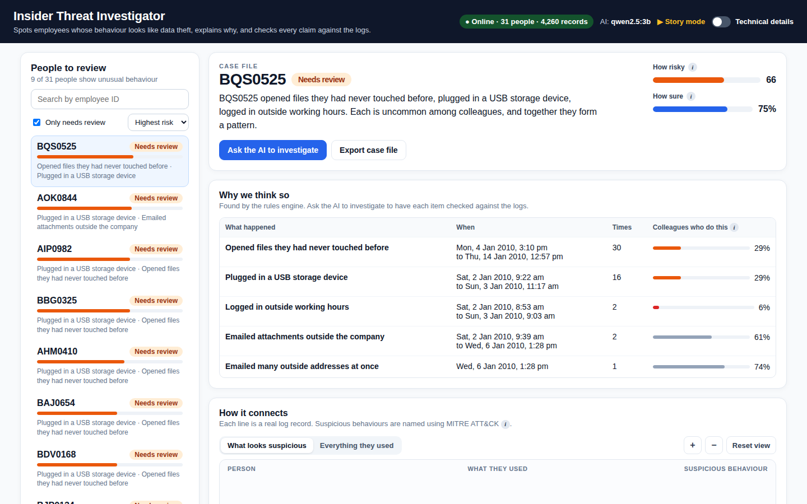
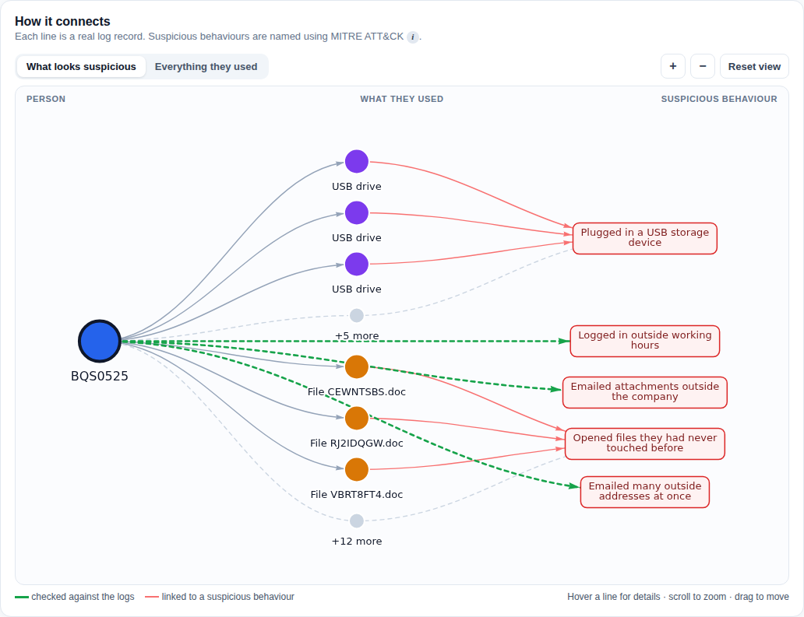

# Cyber Intelligence GraphRAGs for Behavioral Detection

An explainable GraphRAG system that detects multi-stage insider threats in enterprise logs, explains each verdict in plain language, and **verifies every claim against the evidence before an analyst sees it**.

Group 17 · Mukadam Mohd. Tabrez (231834) · Shaikh Mohd. Faizan (231854) · Shamsi Mohammed Bilal (231855)
Guide: Er. Pragati Pal · Release `v1.1-sem7`

> **See it first:** open the dashboard and click **▶ Story mode**, or double-click [`docs/story.html`](docs/story.html), a 12-scene walkthrough of one insider case written for non-technical audiences. No install needed.

| Case file (plain language by default) | Evidence graph (checked links in green) |
|---|---|
|  |  |

The dashboard speaks plain language by default. Switch on **Technical details** in the header to see raw IDs, edge lists, ATT&CK codes, graph depth and the formal metrics.

---

## What it does

1. **Reads behavioural logs.** Logons, USB devices, files, email and web activity from the CERT r4.2 insider-threat dataset (Carnegie Mellon University).
2. **Connects the dots.** Builds a knowledge graph where every event is a chain *user → computer → file/USB/email/URL*, and maps suspicious behaviour to **MITRE ATT&CK** techniques.
3. **Retrieves the relevant evidence.** Pulls the subgraph around a user for an analyst's question.
4. **Reasons with an LLM.** Produces a verdict and risk score that must cite the exact graph edges it relies on.
5. **Fact-checks the AI (core contribution).** Every cited edge is checked against the graph. Ungrounded answers are regenerated (up to twice). If they still fail, the answer is marked `[unverified]` and its risk is cut by 20% instead of being shown with false confidence.
6. **Scores confidence.** Confidence comes only from verified evidence paths: edge confidences multiply, older evidence decays (×0.95 per day), and behaviour common among colleagues is discounted.
7. **Shares results in the industry standard.** Exports STIX 2.1, using MITRE's official ATT&CK objects.

## SoP objectives — status

| Objective | Status | Where |
|---|---|---|
| 1. Ingestion + knowledge graph from CERT logs, ATT&CK-mapped in STIX 2.1 | ✅ Done | `ingestion/`, `scripts/build_graph_from_cert.py`, `intel/stix_export.py` |
| 2. GraphRAG retrieval + LLM verdicts with risk scores | ✅ Done (any OpenRouter / Anthropic / OpenAI / Groq / Gemini model, or local Ollama) | `retrieval/`, `reasoning/verdict_generator.py` |
| 3. Groundedness self-verification | ✅ Done and evaluated | `reasoning/groundedness_checker.py`, `docs/groundedness_design.md` |
| 4. Interactive dashboard *(Sem 8)* | ✅ Delivered early: incident queue, graph, timeline, evidence trail, metrics, Story mode | `dashboard/` |
| 5. Adaptive routing, confidence propagation, evaluation *(Sem 8)* | ◐ Confidence propagation and five-metric evaluation done; routing is rule-based (learned router in Sem 8) | `graph/confidence.py`, `evaluation/`, `retrieval/router.py` |

---

## Quick start (local)

Requires Python 3.11+ and Node 18+.

```bash
git clone https://github.com/Viro-Hunter/Major_Project.git && cd Major_Project
python -m venv .venv && source .venv/bin/activate      # Windows: .venv\Scripts\activate
pip install -r requirements.txt
cp .env.example .env

# terminal 1 — API (a prebuilt CERT graph loads automatically)
uvicorn api.main:app --port 8000

# terminal 2 — dashboard
cd dashboard && npm install && npm run dev
```

Open **http://localhost:5173**. The dashboard proxies every API call through its own port. `scripts/setup.sh` and `scripts/run.sh` wrap the same steps and also pull a local Ollama model.

### Running in a hosted sandbox (Manus, GitHub Codespaces, a remote VM)

Start both servers as above, then **expose only port 5173**. The browser talks to the dashboard, and the dashboard forwards API calls to the API inside the sandbox, so `localhost` confusion and CORS do not arise. If the API runs elsewhere, start the dashboard with `API_TARGET=http://<api-host>:8000 npm run dev`. If the browser must call a separate public API URL directly, set `VITE_API_URL` to that URL instead.

### Choosing the reasoning model

Use the **Reasoning model** panel at the top of the dashboard:

1. Paste an API key. The provider is detected as you type (`sk-or-` OpenRouter, `sk-ant-` Anthropic, `sk-proj-`/`sk-` OpenAI, `gsk_` Groq, `AIza` Gemini, `xai-` xAI). You can override it.
2. Click **Check key**. The API verifies the key with the provider.
   - **OpenRouter with credit:** paid models are unlocked and the newest Claude Sonnet is preselected. Each option shows an estimated cost per verdict and your remaining credit.
   - **Free tier or no credit left:** only free models are listed, and the strongest one for JSON reasoning is selected automatically.
3. Switch models any time, and use **Send test prompt** to confirm the model answers.

The key is held in the API process's memory only. It is never written to disk, logged, or returned to the browser, and it is forgotten on restart. To keep it, put it in `.env`:

```bash
LLM_PROVIDER=openrouter
OPENROUTER_API_KEY=sk-or-v1-...
OPENROUTER_MODEL=auto     # best model for this key; or name one, e.g. meta-llama/llama-3.3-70b-instruct:free
```

With no key the system tries local Ollama. If no model answers, verdicts come from a deterministic evidence template, which is grounded by construction.

### First queries

```bash
curl localhost:8000/health
curl "localhost:8000/incidents/queue?limit=5"                     # users ranked by behavioural risk
curl -X POST localhost:8000/incidents/analyze -H "Content-Type: application/json" \
     -d '{"entity":"BQS0525","query":"Is this user exfiltrating data?"}'
curl localhost:8000/incidents/BQS0525/stix > case.stix.json        # the same verdict as STIX 2.1
```

Interactive API docs: http://localhost:8000/docs.

---

## Asking questions — and what the tool refuses

The **Ask a question** box answers questions about one person's *work activity* (logins, USB devices, files, email, websites, why they were flagged) as a conversation under the box; it never changes the case verdict. Every answer lists the log records it relies on and is checked against them.

- **With an AI model connected**, the model answers in plain English and must cite record ids. Invented ids are caught, the model gets one constrained retry, and the answer is then marked "treat with caution".
- **Without a model, or if its reply can't be used**, common question types are answered straight from the logs, and the UI says *why* the model wasn't used (rate limit, timeout, wrong format, no evidence cited).
- **Questions about protected or personal characteristics are declined** before any model is called, and the attempt is written to the audit log (`reasoning/scope_guard.py`). This covers sexual orientation, religion, caste or ethnicity, health, politics, relationships and appearance. Logs can't answer such questions, and profiling employees on them is unfair and unlawful. The AI's instructions carry the same rule as a second layer.

## Story mode (presentations)

Twelve presenter-paced scenes (→ / Space / ←) follow one employee from ordinary weeks to two late nights of data theft. Each step is shown in plain language: connecting the dots, comparing with colleagues, the AI's answer, the fact-check rejecting an invented claim, confidence, the STIX export, and measured results.

- In the dashboard: **▶ Story mode** (or `/#story`). Needs no API.
- As one offline file: `docs/story.html`. Double-click it; no server or install.
- Every number comes from a real run. Regenerate after new results with `python scripts/build_story.py && python scripts/export_story_html.py`.
- `python scripts/demo.py --pause` tells the same case in the terminal.

## STIX 2.1 output

`GET /incidents/{entity}/stix` returns the checked verdict as a STIX 2.1 bundle. It contains:

- a report and a suspected threat actor;
- MITRE's **official** ATT&CK `attack-pattern` objects, with their original identifiers, from `data/attack_patterns.stix21.json` (rebuilt by `scripts/extract_attack_stix.py`);
- sightings and observed data;
- a note recording the groundedness result.

Only verified evidence is exported. Bundles pass the OASIS `stix2-validator` in the test suite.

---

## Testing and evaluation

```bash
pytest -q                                   # 152 tests; no API key or model needed
python scripts/run_pipeline_e2e.py          # all 7 stages on 20 users, per-stage timing; exit 1 on any error
python evaluation/run_benchmark.py          # five metrics -> evaluation/results/benchmark_report.md
python scripts/generate_report_assets.py    # figures -> docs/report_assets/, captioned tables -> docs/report_tables.md
```

**Real-LLM comparison.** With an OpenRouter key in `.env`, run:

```bash
python evaluation/compare_models.py --sleep 4            # evidence template vs your LLM, same 30 users
python evaluation/compare_models.py --sleep 4 --hybrid   # + LLM extraction of implicit relations
```

`evaluation/results/model_comparison.md` reports detection quality and, for the real model, how many verdicts cited evidence that does not exist and how many of those the self-check repaired or flagged. `--sleep 4` keeps free models under their rate limit.

**Extraction.** Structured CERT fields are extracted by rules, which is exact and free. `--extractor hybrid` (benchmark) or `--llm-extract` (e2e) adds LLM-inferred relations from windows of each user's events, capped at 0.6 confidence. Entities the model names that do not appear in the events it was shown are rejected.

**Ground truth.** With the official answer key in `data/raw/answers/` (`python scripts/fetch_cert_data.py answers`), the benchmark uses real labels. Otherwise it injects seeded insider scenarios, modelled on the three published r4.2 scenarios, into real users' activity, and says so in every report.

Current results (injected ground truth, 60 users / 12 insiders, offline template; full tables in `evaluation/results/benchmark_report.md`):

| Metric | Value |
|---|---|
| Detection | precision 0.636, recall 0.583, F1 0.609, false-positive rate 8.3% |
| Without the peer-prevalence discount (ablation) | F1 0.462, false-positive rate 58.3% |
| Naive baseline (any ATT&CK match ⇒ insider) | false-positive rate 100% |
| Graph completeness | 100% |
| Threat-correlation precision | 0.440 |
| Evidence retrieval F1 | 0.319 |
| Response time | ~3 s graph build, ~16 ms per query |
| Groundedness under simulated hallucination | 15/15 fabricated citations caught, 0 false alarms |

---

## Configuration

Only variables the code actually reads. See `.env.example`.

| Variable | Purpose |
|---|---|
| `LLM_PROVIDER` | `openrouter`, `anthropic`, `openai` (also used for Ollama), `groq`, `gemini`, `xai` |
| `OPENROUTER_API_KEY`, `OPENROUTER_MODEL` | OpenRouter key; model id or `auto` |
| `ANTHROPIC_API_KEY`, `LLM_MODEL` | Anthropic key and model |
| `OPENAI_API_BASE`, `OPENAI_API_KEY`, `OPENAI_MODEL` | OpenAI, or local Ollama via `http://localhost:11434/v1` (default model `qwen2.5:3b`) |
| `GROQ_API_KEY`, `GEMINI_API_KEY`, `XAI_API_KEY` | Other providers |
| `CYBERGRAPHRAG_OFFLINE=1` | Skip the `.env`/Ollama model and use the evidence template (CI, benchmarks). A key connected in the dashboard still wins |
| `ACTION_AUTO_THRESHOLD`, `ACTION_ANALYST_THRESHOLD` | Action-gate thresholds |
| `CERT_USERS`, `CERT_ROWS_PER_USER`, `CERT_SAMPLE_RATIO` | Size of the CERT graph built at startup |
| `LOG_LEVEL` | Logging level |
| `API_TARGET`, `VITE_API_URL` | Dashboard: where the proxy forwards API calls / direct API URL (hosted setups) |

## Repository layout

```
ingestion/     CERT log parsing and loading            extraction/   rule + LLM entity/relation extraction
graph/         NetworkX graph store, confidence math   retrieval/    query router, graph retriever
reasoning/     verdicts, groundedness check, evidence, confidence    intel/   STIX 2.1 export
llm/           provider detection, key check, client   action/       action gate and audit log
api/           FastAPI routes                          dashboard/    React dashboard + Story mode
evaluation/    metrics, benchmark, scenarios, model comparison       scripts/  graph build, e2e, demo, report assets
data/          demo CERT subset, ATT&CK lookup, MITRE STIX objects   docs/     architecture, design notes, report assets
tests/         152 tests
```

## Changelog by week

What each week of the Semester 7 plan delivered. Commit dates are the real dates in `git log`; Weeks 9–12 were integrated and pushed in October 2026. Day-by-day detail is in [CHANGELOG.md](CHANGELOG.md), and the logbook wording is in [docs/WEEKLY_LOG.md](docs/WEEKLY_LOG.md).

| Week | Planned | Delivered (where in the repo) |
|---|---|---|
| 1 | Scope, architecture, repo scaffold | Folder structure (`ingestion/`, `extraction/`, `graph/`, `retrieval/`, `reasoning/`, `evaluation/`), FastAPI app with `/health`, React + Vite dashboard skeleton |
| 2 | Literature survey, data sources | Survey of 7 papers; CERT r4.2 exploration (`scripts/explore_cert.py`, `docs/cert_dataset_notes.md`) |
| 3 | Problem statement, graph schema | Entity/relation schema (`graph/schema.py`); CERT preprocessing into a working subset (`data/demo/`) |
| 4 | Ingestion + extraction pipeline | `ingestion/log_parser.py`; LLM entity/relation extractor with prompt template (`extraction/`) |
| 5 | Knowledge graph + ATT&CK mapping | `graph/graph_store.py`; behaviour → technique lookup (`data/attack_technique_lookup.json`); graph view in the dashboard |
| 6 | GraphRAG retrieval + router | `retrieval/graph_retriever.py`; rule-based `retrieval/router.py` (structural / lookup / hybrid) |
| 7 | LLM reasoning, first end-to-end verdict | `reasoning/verdict_generator.py`; verdict and risk shown on the dashboard |
| 8 | Groundedness self-check (core novelty) | `reasoning/groundedness_checker.py`: verify cited edges, regenerate ≤ 2×, else downgrade + `[unverified]`; `docs/groundedness_design.md` |
| 9 | Integration + confidence propagation | `graph/confidence.py` (Π confidence × 0.95/day decay); `reasoning/evidence.py`, `reasoning/confidence_scoring.py`; `scripts/run_pipeline_e2e.py`; incident queue; edge-endpoint bug fix; retrieval 852 → 16 ms |
| 10 | Evaluation metrics | `evaluation/metrics.py`, `evaluation/run_benchmark.py`, `evaluation/scenarios.py` (five metrics, ablation, baseline, groundedness fault injection); metrics panel |
| 11 | Report writing + assets | `scripts/generate_report_assets.py` (figures, captioned tables, architecture summary); accurate `docs/ARCHITECTURE.md` |
| 12 | Final polish, demo, presentation | `scripts/demo.py` live walkthrough; README setup; tag `v1.0-sem7` |

**After Week 12 (presentation readiness, `v1.1`–`v1.2`)**
- **Model choice:** pasted API keys are auto-detected (OpenRouter, Anthropic, OpenAI, Groq, Gemini); the system checks credit and picks paid or free models (`llm/providers.py`).
- **Native STIX 2.1 export:** uses MITRE's official ATT&CK objects and is validated with the OASIS validator (`intel/stix_export.py`).
- **Hybrid LLM extraction:** extraction-time grounding (`extraction/llm_enrichment.py`) and a template-vs-LLM comparison (`evaluation/compare_models.py`).
- **Story mode:** a 12-scene presentation for non-technical audiences, also available as one offline file (`docs/story.html`).
- **Question answering with a scope guard:** answers appear under the box and are checked against log records; protected-characteristic questions are refused and audited; the AI's reply parsing now tolerates reasoning models, and every fallback states its reason (`reasoning/qa.py`, `reasoning/scope_guard.py`).
- **Dashboard redesign:** plain language by default with a Technical details switch. People-to-review list, case file, verified-evidence table with colleague comparison, a stable evidence-first graph, an activity chart, outcome-based metrics, and no sideways overflow on laptop, projector or phone.

## Documentation

- [docs/ARCHITECTURE.md](docs/ARCHITECTURE.md): pipeline, modules, design decisions
- [docs/groundedness_design.md](docs/groundedness_design.md): the core contribution
- [docs/WEEKLY_LOG.md](docs/WEEKLY_LOG.md): progress, Weeks 9–12
- [docs/cert_dataset_notes.md](docs/cert_dataset_notes.md), [docs/demo_dataset.md](docs/demo_dataset.md): data
- [docs/OLLAMA.md](docs/OLLAMA.md), [docs/TRAINING.md](docs/TRAINING.md): local models and optional fine-tuning
- [evaluation/results/benchmark_report.md](evaluation/results/benchmark_report.md), [docs/report_tables.md](docs/report_tables.md): results
- [CHANGELOG.md](CHANGELOG.md)

## Limitations

- Results above use injected insider scenarios. Official answer-key numbers require downloading the key.
- The committed graph and benchmark use a demo subset of CERT r4.2, not the full dataset.
- The query router is rule-based. The "semantic" retriever is a text-similarity fallback, not a vector database (Chroma/FAISS is planned).
- The action gate simulates responses (block, re-authenticate). Nothing touches real systems.

## Roadmap — Semester 8

- Evaluate on the official CERT answer key and across several real LLMs.
- Learned query router and vector retrieval (Chroma/FAISS); Neo4j for scale.
- Live threat-intelligence ingestion (STIX/TAXII), agentic hunting.
- Comparison with published UEBA baselines; research paper.

## License and acknowledgements

MIT. See [LICENSE](LICENSE). CERT Insider Threat Dataset © Carnegie Mellon University; MITRE ATT&CK® © The MITRE Corporation, used under its terms of use.
